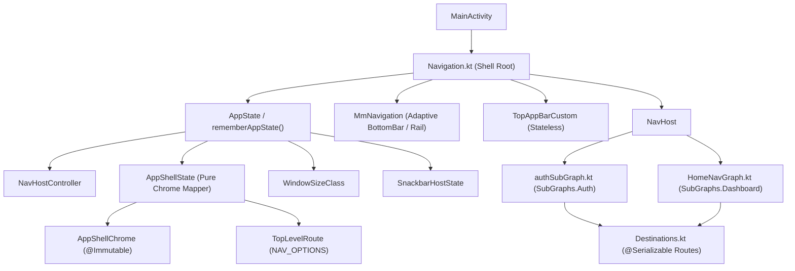

# Navigation Shell Architecture

This document explains the components that compose the Jetpack Navigation Compose shell in `MeteoMartoCompose`, how responsibilities are split across `ui/navigation/`, and how adaptive chrome, type-safe routing, and process-death restoration work together.

---

## 1. Component Map

All navigation contracts, state holders, sub-graphs, and shell chrome live under `com.martorell.albert.meteomartocompose.ui.navigation`:

| File | Role | Owns State / Runtime? |
| :--- | :--- | :---: |
| `ui/navigation/Navigation.kt` | Root composable assembling `AppState`, `MmNavigation`, `TopAppBarCustom`, `FloatingActionButton`, `MmSnackbarHost`, and `NavHost`. | Yes (Compose lifecycle boundary) |
| `ui/navigation/AppState.kt` | `@Stable` hoisted navigation state holder created by `rememberAppState()`. Owns `NavHostController`, `SnackbarHostState`, `CoroutineScope`, `WindowSizeClass`, and intent-driven navigation methods. | Yes (Compose/Navigation runtime) |
| `ui/navigation/AppShellState.kt` | Pure, stateless mapper translating `NavBackStackEntry?` into `@Immutable AppShellChrome` and top-level tab selection (`isTopLevelRouteSelected`). Directly unit-tested on the JVM (`AppShellStateTest`). | **No** (pure Kotlin logic) |
| `ui/navigation/Destinations.kt` | Type-safe Kotlinx Serialization route definitions (`SubGraphs`, `AuthScreens`, `DashboardScreens`) and tab-switching helper `navigatePoppingUpToStartDestination<T>`. | **No** (contracts only) |
| `ui/navigation/TopLevelRoute.kt` | `@Immutable` descriptor pairing a top-level route with `@StringRes titleRes` and `ImageVector icon`. | **No** (value descriptor) |
| `ui/navigation/HomeNavGraph.kt` | Authenticated `SubGraphs.Dashboard` graph (`CityForecast`, `Favorites`, `HighTemperatureAlert` dialog + deep link). | No (graph wiring) |
| `ui/navigation/authSubGraph.kt` | Unauthenticated `SubGraphs.Auth` graph (`Login`, `SignUp`, `Terms`). | No (graph wiring) |
| `ui/navigation/shared/TopAppBarCustom.kt` | 100% stateless top app bar rendering `MmText.TitleLarge` with optional Back navigation and Logout actions. | **No** (stateless UI) |
| `ui/designsystem/components/MmNavigation.kt` | Design System adaptive navigation shell switching automatically between compact Bottom Navigation Bar (`< 600dp`) and expanded Navigation Rail (`>= 600dp`), decoupled from `NavDestination` via `isItemSelected`. | **No** (stateless DS component) |

---

## 2. `AppState` vs. `AppShellState`

Separating `AppState` from `AppShellState` keeps Compose/Navigation infrastructure cleanly decoupled from deterministic shell-chrome business rules:

* **`AppShellState` (Pure Decision Engine)**
  * Holds **zero** `NavHostController`, `CoroutineScope`, or Compose runtime state.
  * Classifies the active `NavBackStackEntry?` into an internal exhaustive `ShellDestination` (`CurrentLocationForecast`, `FavoriteCityDetail`, `FavoritesList`, `Other`) using proactive `hasRoute<T>()` checks (no `try-catch` control flow).
  * Maps each `ShellDestination` deterministically to an `@Immutable AppShellChrome` (visibility of bottom navigation, top bar, title resource, back button, logout action, and favorite FAB) and computes `isTopLevelRouteSelected(...)`.
  * Because it has no Android runtime dependencies, all routing chrome combinations are tested directly in pure JVM unit tests (`AppShellStateTest`).

* **`AppState` (Hoisted Compose Orchestrator)**
  * Annotated `@Stable` and instantiated once via `rememberAppState()`.
  * Owns live UI infrastructure: `navController`, `snackbarHostState`, `coroutineScope`, `windowSizeClass` (`currentWindowAdaptiveInfo().windowSizeClass`), and `fabState`.
  * **Delegates** chrome and tab-selection queries to `AppShellState` (`shellChrome`, `isTopLevelRouteSelected(entry, route)`).
  * Exposes **intent-driven navigation actions** (`onNavItemClick`, `navigateToDashboard`, `navigateToAuth`, `navigateToSignUp`, `navigateToTerms`, `navigateToCityForecast`, `navigateToHighTemperatureAlert`, `navigateUp`) plus `dashboardBackStackEntryOrNull(currentEntry)` so sub-graphs never manipulate raw `NavOptionsBuilder` flags directly.

---

## 3. Type-Safe Routes & Unified `CityForecast` Contract

`Destinations.kt` defines two sub-graphs (`SubGraphs.Auth` and `SubGraphs.Dashboard`) with primitive, process-death-safe arguments only:

* **`SubGraphs.Auth`** (`startDestination = AuthScreens.Login`): `Login`, `SignUp`, `Terms`.
* **`SubGraphs.Dashboard`** (`startDestination = DashboardScreens.CityForecast()`):
  * **`DashboardScreens.CityForecast(val cityName: String? = null)`**: Unified forecast destination serving both modes:
    * `cityName == null` (or blank, normalized via `CityForecast.fromCityName(...)`) -> **Current Location** mode (`isFavoriteDetail == false`).
    * Non-blank `cityName` -> **Favorite City Detail** mode (`isFavoriteDetail == true`).
    * The `cityName` parameter name matches the `SavedStateHandle["cityName"]` key so non-root favorite details survive Activity recreation and OS LMK process death without passing heavy domain objects through Binder `Bundle`s.
  * **`DashboardScreens.Favorites`**: Single unique Favorites list route (zero duplicate registrations).
  * **`DashboardScreens.HighTemperatureAlert(val temperature: Double)`**: Full-screen `dialog` destination wired to the `meteomarto://alert/high-temperature/{temperature}` deep link (`AppConstants.DEEP_LINK_BASE`).

### Tab-Switching Backstack Hygiene (`navigatePoppingUpToStartDestination<T>`)

When an app launches logged out (`startDestination = SubGraphs.Auth`) and then clears `SubGraphs.Auth` after login, `graph.findStartDestination().id` still refers to `AuthScreens.Login` (no longer on the backstack). Parameterizing `NavHostController.navigatePoppingUpToStartDestination<DashboardScreens.CityForecast>(route)` anchors `popUpTo<T> { saveState = true }` explicitly on the authenticated dashboard root with `launchSingleTop = true` and `restoreState = true`, preventing backstack accumulation across both cold-start logged-in and post-login sessions.

---

## 4. Shell Chrome Matrix (`AppShellState` -> `AppShellChrome`)

| `ShellDestination` | Bottom Bar / Rail | TopAppBar | Title Resource | Back Arrow | Logout Action | Favorite FAB | Selected Tab |
| :--- | :---: | :---: | :--- | :---: | :---: | :---: | :--- |
| `CurrentLocationForecast` (`CityForecast(null)`) | Yes | Yes | `R.string.city_top_bar_title` | No | Yes | Yes | `City` |
| `FavoritesList` (`Favorites`) | Yes | Yes | `R.string.favorite_top_bar_title` | No | No | No | `Favorites` |
| `FavoriteCityDetail` (`CityForecast("Barcelona")`) | No | Yes | `R.string.city_weather_detail` | Yes | No | No | None |
| `Other` (`Auth*`, `HighTemperatureAlert`, `null`) | No | No | `null` | No | No | No | None |

---

## 5. Key Shell Patterns

### Stateless `TopAppBarCustom` (Decoupled from `AppState` & Hilt)
`TopAppBarCustom` accepts only plain UI state and callbacks (`title`, `showBackButton`, `onBackClick`, `showLogoutAction`, `onLogoutClick`, `scrollBehavior`). Removing `AppState`, `NavDestination`, and `hiltViewModel<CityWeatherViewModel>()` from the bar ensures:
* Unidirectional Data Flow (state flows down from `Navigation.kt`, events bubble up via lambdas).
* Full `@MmPreview` and `@MmDevicePreview` support without Hilt runtime crashes (wrapped in `Surface(color = MeteoMartoTheme.colors.background)` because the bar uses `containerColor = Color.Transparent` to sit cleanly over atmospheric backgrounds).
* Zero coupling to a specific screen's `ViewModel` when forecast ViewModels are unified downstream.

### Shared `TopAppBarState` Scroll Reset
`Navigation.kt` shares a single `TopAppBarDefaults.enterAlwaysScrollBehavior(scrollState)` across destinations. A `LaunchedEffect(currentBackStackEntry?.id)` resets `scrollState.heightOffset = 0f` and `scrollState.contentOffset = 0f` on every destination transition so that collapsing the top bar by scrolling on one screen (e.g., `Favorites`) never leaves the top bar collapsed or hidden upon navigating to another screen (e.g., `CityForecast`).

### Lifecycle-Aware State Collection (`collectAsStateWithLifecycle`)
`Navigation.kt` collects `mainViewModel.state` and `designSystemViewModel.fontScale` with `collectAsStateWithLifecycle()` instead of `collectAsState()`. Unlike `collectAsState()`, which keeps collecting upstream `Flow`s even while the app is backgrounded (`Lifecycle.State.STOPPED`), `collectAsStateWithLifecycle()` automatically cancels upstream collection below `STARTED` and resumes seamlessly on foreground return, saving resources and pairing cleanly with `SharingStarted.WhileSubscribed(5_000)`.
